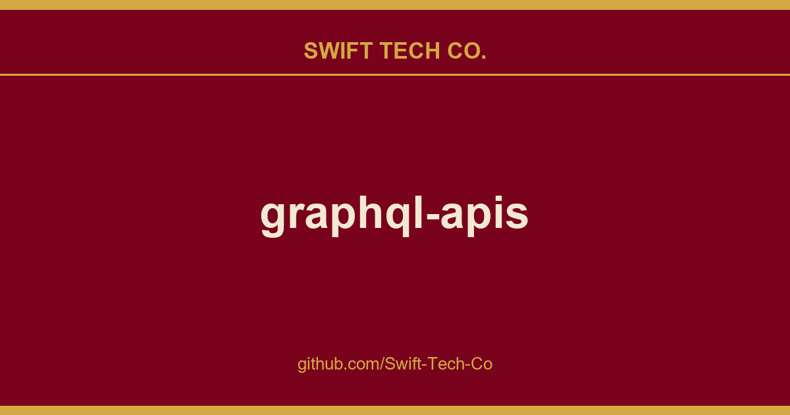

# graphql-apis

## What This Is

This is part of the Swift Tech Co. working stack for product and engineering. It gathers the graphql-apis notes, examples and fixes that keep delivery fast, and doubles as the reference map we hand to whoever picks up this thread next.

## Images

## Official APIs

| API | Description | Graph*i*QL | Docs/Repo
| --- | ----------- | :--------: | :-: |
| AniList | Anime and manga datum, including character, staff, and live airing data. | Try it! | Docs
| Artsy | free online platform for collecting and discovering art | Try it! | Repo
| Bitquery | on-chain blockchain analytics | Try it! | Docs
| Braintree | Payment platform | Try it! | Docs
| Buildkite | Continuous integration and deployments | Try it! | Docs
| Canopy | The missing GraphQL API for Amazon.com e-commerce | Try it! | Repo  Docs         |
| Catalysis Hub | Chemical surface reaction energies and structures | Try it! | Repo  Docs
| Changetrip | The Chargetrip API gives you the ability to integrate smart, EV-specific routing into products built for electric car drivers. | Try it! | Docs
| CommerceTools | e-commerce solutions | Try it! | Docs
| Contentful | "CMS as a Service". Graph*i*QL demo allows to query a simple blog, but the library itself generates a schema automatically for any content model you store in Contentful. | Try it!%20%7B%0A%20%20%20%20items%20%7B%0A%20%20%20%20%20%20title%0A%20%20%20%20%20%20slug%0A%20%20%20%20%20%20modulesCollection(limit%3A%202%2C%20skip%3A%201)%20%7B%0A%20%20%20%20%20%20%20%20total%0A%09%09%09%09limit%0A%09%09%09%09skip%0A%20%20%20%20%20%20%20%20items%20%7B%0A%20%20%20%20%20%20%20%20%20%20...imageUrl%0A%09%09%09%09%09...%20on%20LessonCodeSnippets%20%7B%0A%20%20%20%20%20%20%20%20%20%20%20%20title%0A%20%20%20%20%20%20%20%20%20%20%7D%0A%20%20%20%20%20%20%20%20%20%20...%20on%20LessonCopy%20%7B%0A%20%20%20%20%20%20%20%20%20%20%20%20sys%20%7B%0A%20%20%20%20%20%20%20%20%20%20%20%20%20%20id%0A%20%20%20%20%20%20%20%20%20%20%20%20%7D%0A%20%20%20%20%20%20%20%20%20%20%20%20title%0A%20%20%20%20%20%20%20%20%20%20%7D%0A%20%20%20%20%20%20%20%20%7D%0A%20%20%20%20%20%20%7D%0A%20%20%20%20%7D%0A%20%20%7D%0A%7D%0A%0Afragment%20imageUrl%20on%20LessonImage%20%7B%0A%20%20title%0A%20%20image%20%7B%0A%20%20%20%20url%0A%20%20%7D%0A%7D) | Docs
| Countries | Information about countries, continents, and languages, based on Countries List | Try it! | Repo
| Deutsche Bahn | Infrastructure Data, like realtime facility status, stations, timetables and more | Try it! | Repo
| Digitransit HSL | Transit routes and realtime schedules from Helsinki Regional Transport Authority, Finland | Try it! | Docs
| EAN-Search | Search barcodes and products | Try it! | Docs
| EHRI | Holocaust-related archival materials | Try it! | Docs
| EtMDB | Ethiopian Movie Database | Try it!%20%7B%0A%20%20%20%20edges%20%7B%0A%20%20%20%20%20%20node%20%7B%0A%20%20%20%20%20%20%20%20slug%0A%20%20%20%20%20%20%20%20hallName%0A%20%20%20%20%20%20%7D%0A%20%20%20%20%7D%0A%20%20%7D%0A%7D%0A) | Docs
| FaunaDB | Serverless GraphQL Database | Try it! | Docs
| Gdom | DOM Traversing and Scraping using GraphQL | Try it! | Repo
| GitHub | Web-based Git repository hosting service | Try it! | Docs
| GitLab | Host-your-own Git repository hosting service | Try it! | Docs
| GraphLoc  | Find a geolocation of an IP address including latitude, longitude, city, country, time zone and area code. Free to use, SSL supported | Try it! | Docs
| GraphQL Jobs | GraphQL jobs in modern startups | Try it! | Docs|
| HIVDB | A curated database to represent, store and analyze HIV drug resistance data | Try it! | Docs
| Idobata | Dedicated chat for team development. | Try it! | |
| leanIX | Tools for business strategy | | Docs
| Pipefy | The operations excellence platform. | Try it! | Docs |
| Mattermark | Business research and networking | | Docs
| Memair | Quantified self / extended mind platform | Try it! | Docs
| melodyRepo | Fast and reliable dependency manager for Go | Try it! | Docs
| monday.com | Connect to your monday data with the platform API. An expressive API to interact with your workflows, automate processes, power integrations, and more. | Try it! | Docs
| React Finland | React Finland API is built with conferences and meetups in mind | Try it! | Repo
| Saleor | Headless open-source E-commerce API for storefront and admin | Try it! | Docs
| Shopify Storefront | The Storefront API gives you full creative control to build customized purchasing experiences for your customers. | Try it! | Docs Examples
| Shopify Admin | The Admin API is the primary way that apps and services interact with Shopify. | Try it! | Docs
| SWOP | GraphQL and REST foreign exchange rate API. Note: Required registration. | Try it! | Docs
| Universe |  Check what your friends are doing & find unique events near you using our filter. | Try it! | Docs
| Yelp  | User Reviews and Recommendations of Top Restaurants, Shopping, Nightlife, Entertainment, Services and More | Try it! | Docs
| TravelgateX | The global marketplace for the travel trade | Try it! | Docs
| TCGdex | A Multilanguage Pokémon TCG Database with Cards Pictures and most of the informations contained on the cards. | Try it! | Repo

## Unofficial API proxies

| API | Description | Graph*i*QL | Docs/Repo
| --- | ----------- | :--------: | :-: |
| Barcelona Urban Mobility API | Information about the different public transport / urban mobility services of Barcelona | Try it! | Repo
| Câmara dos deputados Brasil | "GraphQL api to grab the data from the brazilian deputies chamber" | Try it! | Repo
| Ghibliql | "GhibliQL is a GraphQL wrapper to the Studio Ghibli REST API" | Try it! | Repo
| Favware's GraphQL Pokémon | Query for all the Pokémon, and their abilities, moves, items, learnsets, and type matchups from generations 1 through 8. This API strives to always stay up-to-date with new Pokémon releases, and has multiple contributors to achieve this. | Try it! | Repo|
| MetaMate | Semantic service bus example for HackerNews | Try it! | Repo Examples
| MusicBrainz |  Open music encyclopedia that collects music metadata | Try it!%20%7B%0A%20%20%20%20%20%20name%0A%20%20%20%20%20%20releaseGroups(type%3A%20ALBUM)%20%7B%0A%20%20%20%20%20%20%20%20edges%20%7B%0A%20%20%20%20%20%20%20%20%20%20node%20%7B%0A%20%20%20%20%20%20%20%20%20%20%20%20title%0A%20%20%20%20%20%20%20%20%20%20%20%20firstReleaseDate%0A%20%20%20%20%20%20%20%20%20%20%20%20relationships%20%7B%0A%20%20%20%20%20%20%20%20%20%20%20%20%20%20releaseGroups(type%3A%20%22single%20from%22)%20%7B%0A%20%20%20%20%20%20%20%20%20%20%20%20%20%20%20%20edges%20%7B%0A%20%20%20%20%20%20%20%20%20%20%20%20%20%20%20%20%20%20node%20%7B%0A%20%20%20%20%20%20%20%20%20%20%20%20%20%20%20%20%20%20%20%20target%20%7B%0A%20%20%20%20%20%20%20%20%20%20%20%20%20%20%20%20%20%20%20%20%20%20...%20on%20ReleaseGroup%20%7B%0A%20%20%20%20%20%20%20%20%20%20%20%20%20%20%20%20%20%20%20%20%20%20%20%20title%0A%20%20%20%20%20%20%20%20%20%20%20%20%20%20%20%20%20%20%20%20%20%20%20%20firstReleaseDate%0A%20%20%20%20%20%20%20%20%20%20%20%20%20%20%20%20%20%20%20%20%20%20%7D%0A%20%20%20%20%20%20%20%20%20%20%20%20%20%20%20%20%20%20%20%20%7D%0A%20%20%20%20%20%20%20%20%20%20%20%20%20%20%20%20%20%20%7D%0A%20%20%20%20%20%20%20%20%20%20%20%20%20%20%20%20%7D%0A%20%20%20%20%20%20%20%20%20%20%20%20%20%20%7D%0A%20%20%20%20%20%20%20%20%20%20%20%20%7D%0A%20%20%20%20%20%20%20%20%20%20%7D%0A%20%20%20%20%20%20%20%20%7D%0A%20%20%20%20%20%20%7D%0A%20%20%20%20%7D%0A%20%20%7D%0A%7D%0A&operationName=NirvanaAlbumSingles) | Repo
| PokeAPI | Pokémon Data API | Try it! | Repo
| Spacex Land | A non official platform for SpaceX's data! | Try it! | Docs
| Spotify | Spotify gives you instant access to millions of songs - from old favorites to the latest hits. | Try it! | Repo Examples
| Stratz | Dota 2 Statistics Api | Try it! | Site
| SWAPI | Star Wars API | Try it! | Repo
| Star-Wars-Api | A fully fledged Star Wars API. Using mostly the same data source as swapi.dev, but way faster (no Django overhead) and easier to query nested data. | Try it! | Repo
| TMDB | The Movie Database Wrapper | Try it! | Repo

## Demonstration-only APIs

| API | Description | Graph*i*QL | Docs/Repo
| --- | ----------- | :--------: | :-: |
| A-Maze | Enter the maze, try to get out! | Try it! | Repo|
| Demotivational Quotes API | Get Random Demotivational quote and its author | Try it! | Repo|
| Lucas Bento's GraphQL Pokémon | Get information of a Pokémon with GraphQL! (**Note**: Only has data on Generation 1, and only has data on Pokémon!) | Try it! | Repo ClientRepo
| MongoDB Northwind demo | Demo App build on top of graphql-compose and mongoose | Try it! Try Relay version! | Docs ServerRepo ClientRepo
| MongoDB TODO-List | TODO List using GraphQL and MongoDb | Try it! | Docs Repo
| Planets | Information about planets and exoplanets, including mass, radius, orbit, semimajor axis, and how it was discovered. | Try it! | Repo
| Spotify GraphQL Server | This demonstrates how to build a GraphQL server which fetches data from an external API (Spotify) | Try it! | Repo
| Three.js demo | Declare a Three.js program with GraphQL | Try it! | Repo
| UFC GraphQL Server | Public UFC API turned into a GraphQL server. It's hosted by now.sh then, sometimes, it gets freeze. | Try it! | Repo
| Google directions API | GraphQL wrapper for google directions API. | Try it! | Repo
| FakeQL | GraphQL API mocking as a service. | Try it! | Docs
| The Rick and Morty API | All the Rick and Morty information. | Try it! | Docs
| UN SDG data series API | UN SDG statistical data served via GraphQL as JSON-LD objects mapped to RDF Data Cube Vocabulary | Try it! | Code Docs Blog post
| Weather API | Retrieve the current weather for any given city | Try it! | Repo
| Fake GraphQL API | Mock user and to do data | Try it! | Docs
| Fruits API | Information of fruit trees of the world | Try it! | Docs

---

## Swift Tech Co.

Built and maintained by Swift Tech Co.

AI Automation | FinTech Platforms | Custom Software and Mobile Apps | SaaS Platforms | Cloud Infrastructure | Cybersecurity | SEO and Marketing | API Integration

**Join our community on Telegram:** [t.me/+Qt_eFvkb2rliMzNh](https://t.me/+Qt_eFvkb2rliMzNh)

Home | Services | Careers | Referral Program | Influencers | About | Contact

**Connect**

- Website: swifttechco.com
- LinkedIn: [linkedin.com/in/stephenoladoke](https://www.linkedin.com/in/stephenoladoke/)
- LinkedIn (Company): [linkedin.com/company/swift-tech-co](https://www.linkedin.com/company/swift-tech-co)
- X: [@MrOladoke](https://x.com/MrOladoke)
- Instagram: [@mr.oladoke](https://www.instagram.com/mr.oladoke/)
- Instagram (Company): [@swifttechco](https://www.instagram.com/swifttechco/)
- Organization: [github.com/Swift-Tech-Co](https://github.com/Swift-Tech-Co)

## Sources

Compiled and maintained from upstream [APIs-guru/graphql-apis](https://github.com/APIs-guru/graphql-apis) under permissive open-source license.

---

Maintained by [Swift Tech Co.](https://github.com/Swift-Tech-Co) - [Telegram](https://t.me/+Qt_eFvkb2rliMzNh)